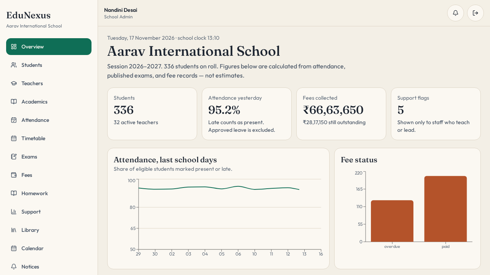
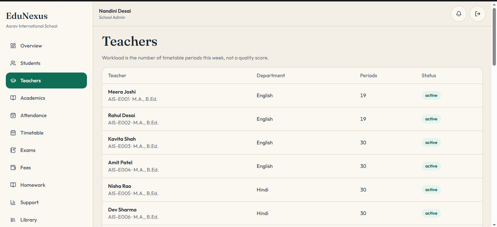
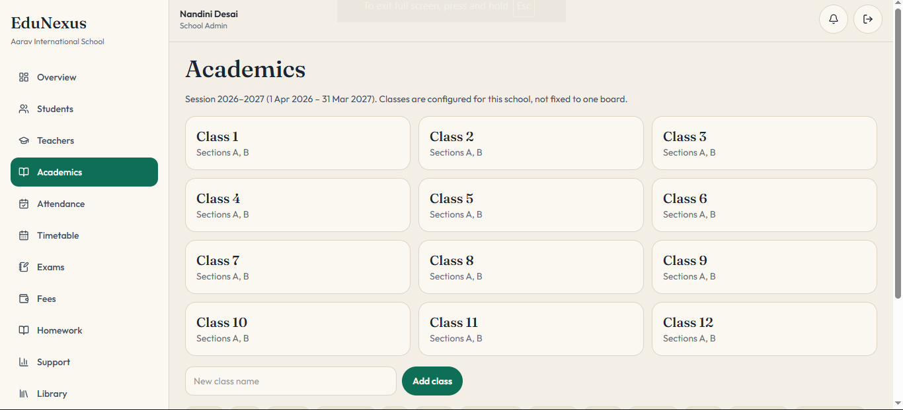
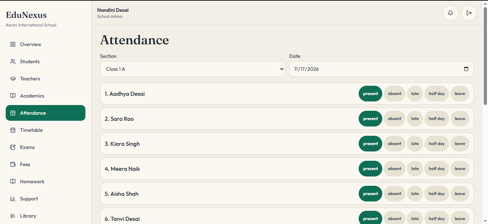
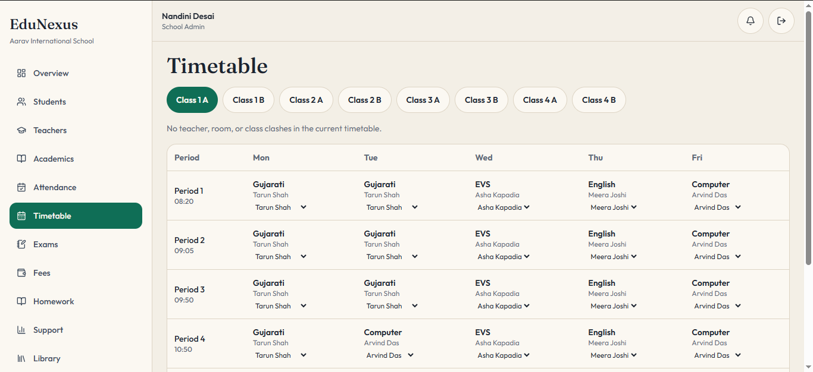
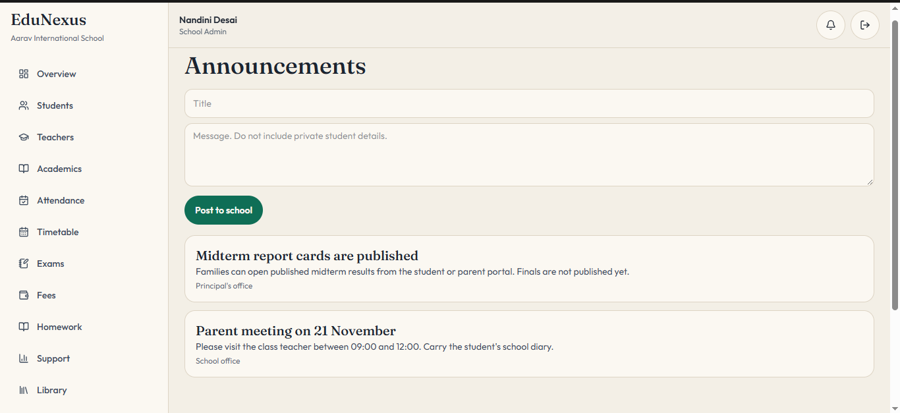
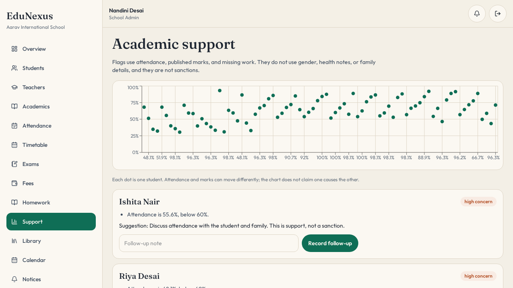

# EduNexus — School Management System

**EduNexus** is a full-stack school management platform built to give schools a single, modern place to run day-to-day academic and administrative work. It combines a role-aware React dashboard with a production-style FastAPI backend (SQLAlchemy, JWT auth, domain services, document generation, and optional integrations).

I built this as a full-stack Python developer to solve the real fragmentation schools face: attendance in one spreadsheet, fees in another, results on paper, and parents stuck waiting for updates. EduNexus brings those pieces into one coherent system with clear roles, audit-friendly APIs, and a polished UI that administrators, teachers, students, and parents can actually use.

---

## Why this project exists

Most schools (especially mid-size institutions in India and similar systems) still juggle:

- Paper registers or disconnected Excel files for attendance and marks
- Separate fee software that does not talk to the academic system
- No unified view for principals or coordinators to spot at-risk students early
- Parents who only hear about problems after report cards or fee dues escalate
- Teachers spending time on repetitive admin instead of teaching

**EduNexus addresses this** by providing:

1. **Role-based access** for Super Admin, School Admin, Principal, Coordinator, Teacher, Student, Parent, Accountant, Librarian, and Receptionist
2. **Core school workflows** in one place: students, teachers, academics, attendance, timetable, exams & results, fees, homework, library, calendar, announcements, and messaging
3. **Insights & early risk signals** so staff can act before a student falls behind
4. **A learning assistant** (rule-based / topic-guided in the demo) that helps students and teachers with common concepts without inventing unsafe answers
5. **A real backend API** with JWT authentication, SQLite (or PostgreSQL), Alembic migrations, seed data, PDF/Excel exports, and mock payment / notification adapters ready for real providers

The frontend currently runs on rich client-side demo state (Zustand + seeded school world) so the UI is fully interactive out of the box. The FastAPI service is a complete, independently runnable API. Wiring the two together is the natural next integration step.

---

## Problem it solves

| Pain point | How EduNexus helps |
|------------|--------------------|
| Scattered data across tools | Single source of truth for students, classes, attendance, marks, fees, library |
| Role confusion & data leakage | Fine-grained permission matrix; sensitive fields gated by role |
| Late discovery of struggling students | Risk scoring / insights surface attendance + performance patterns |
| Manual fee tracking & receipts | Invoice lifecycle, payment recording, receipt generation (PDF) |
| No parent visibility | Parent-scoped views for attendance, results, fees, homework |
| Admin overhead for teachers | Mark attendance, enter marks, publish homework from one dashboard |
| Hard to demo or onboard | Seeded realistic school, Windows one-click setup, OpenAPI docs |

---

## Full workflow (how the system is intended to be used)

```
1. Bootstrap
   - Run setup → install Node + Python deps, create venv
   - Start backend (seeds SQLite DB if empty) + frontend

2. Authenticate (backend API)
   - POST /api/v1/auth/login → access + refresh tokens
   - Role claims drive authorization on subsequent calls

3. School setup (admin)
   - Schools, academic years, classes, sections, subjects, rooms
   - Teachers + assignments (who teaches what to which section)
   - Students + parent links

4. Daily operations
   - Teachers mark attendance sessions
   - Timetable viewed / managed
   - Homework assigned & tracked
   - Library issue / return

5. Assessment cycle
   - Create examinations, enter marks, publish results
   - Generate report cards (PDF)

6. Fees
   - Create invoices, record payments (mock gateway or Razorpay adapter)
   - Receipts & overdue visibility for accountant / parents

7. Communication & support
   - Announcements, calendar events, internal messages
   - AI assistant for study help (demo topics)
   - Risk signals for staff follow-up

8. Oversight
   - Admin / principal overview dashboards
   - Analytics endpoints for attendance, fees, performance snapshots
```

**Frontend demo path:** open the dashboard → switch roles via the UI (demo seed) → explore pages for that role. Data lives in browser state for the demo.

**Backend path:** use Swagger UI at `/docs` or any HTTP client against the versioned API.

---

## Tech stack

### Backend (Python)
- **FastAPI** — API layer, OpenAPI docs, dependency injection
- **SQLAlchemy 2.x** + **Alembic** — models & migrations
- **Pydantic** — settings & validation
- **PyJWT** — access / refresh tokens
- **ReportLab / OpenPyXL** — PDF report cards & Excel export
- **Uvicorn** — ASGI server
- Optional: PostgreSQL (psycopg), MongoDB (documents), Redis + Celery (background tasks)
- Mock adapters for payments, email/SMS, and document storage so the system runs offline

### Frontend
- **React 19** + **TypeScript**
- **TanStack Router / Start** + **Vite**
- **Zustand** — client demo state
- **Tailwind CSS** + **Radix UI** — accessible, modern UI
- **Recharts** — charts for insights
- **Lucide** icons
- Role-aware navigation and permission checks in `src/edunexus/access.ts`

### Tooling & DX
- Windows helper scripts (`setup-windows.bat`, `start-windows.bat`)
- Backend tests (`backend/tests/`)
- Seed data for a realistic multi-role school
- `.env.example` for configuration

---

## Project structure

```
EduNexus/
├── backend/                 # FastAPI application
│   ├── app/
│   │   ├── main.py          # App factory, middleware, lifespan
│   │   ├── models.py        # SQLAlchemy models
│   │   ├── routers/routes.py# All API endpoints
│   │   ├── domain.py        # Business logic
│   │   ├── security.py      # JWT helpers
│   │   ├── seed.py          # Demo data seeding
│   │   ├── ai.py / risk_service.py
│   │   ├── payments.py / pdfs.py / documents.py
│   │   └── ...
│   ├── alembic/             # Migrations
│   ├── tests/
│   ├── requirements.txt
│   └── .env.example
├── src/
│   ├── edunexus/            # School dashboard (pages, store, seed, access)
│   ├── components/
│   ├── lib/                 # Auth helpers, utilities
│   └── routes/              # TanStack file routes
├── screenshots/             # Feature screenshots (see below)
├── scripts/                 # Dev helpers (env wrapper, migrate, …)
├── public/
├── package.json
├── setup-windows.bat
├── start-windows.bat
└── README.md
```

---

## How to run

### Prerequisites
- **Node.js** 20.19+ or 22 LTS (recommended)
- **Python** 3.11+
- Windows, macOS, or Linux

### Windows (easiest)

1. Extract the project folder.
2. Double-click **`setup-windows.bat`** (installs frontend + backend venv).
3. Double-click **`start-windows.bat`**.
4. Open:
   - Dashboard → http://localhost:8080
   - API docs → http://127.0.0.1:8000/docs
   - Health → http://127.0.0.1:8000/api/v1/health

### Manual (any OS)

```bash
# Frontend
npm ci
npm run dev          # http://localhost:8080

# Backend (separate terminal)
cd backend
python -m venv .venv
# Windows: .venv\Scripts\activate
# Unix:    source .venv/bin/activate
pip install -r requirements.txt
export DATABASE_URL=sqlite:///./edunexus.db
export JWT_SECRET=local-dev-access-secret
export JWT_REFRESH_SECRET=local-dev-refresh-secret
export SEED_ON_STARTUP=1
uvicorn app.main:app --reload --host 127.0.0.1 --port 8000
```

Backend will create and seed `backend/edunexus.db` on first start when `SEED_ON_STARTUP=1`.

---

## Results / what you will see

The dashboard is role-aware. Below are real screenshots from the running application.

### Admin overview
High-level snapshot of school health, key counts, and quick navigation.



### Teachers directory
Staff list with department, designation, and status — filtered by role permissions.



### Academics
Classes, sections, subjects, and academic structure management.



### Attendance
Session-based attendance marking and summaries (present / absent / late / half-day / leave).



### Timetable
Period-wise weekly timetable for classes and teachers.



### Announcements
School-wide or targeted announcements visible according to role.



### Support / messaging area
Communication and support surfaces for staff and parents.



Backend interactive documentation is available at `/docs` once the API is running. You can exercise auth, students, attendance, exams, fees, library, calendar, announcements, analytics, and AI/risk endpoints there.

---

## Challenges faced & how they were solved

| Challenge | Approach |
|-----------|----------|
| **Rich domain model** (students, parents, multi-section teachers, fee states, attendance policies, risk) | Explicit TypeScript types + matching SQLAlchemy models; shared vocabulary between frontend seed and backend domain |
| **Role explosion without chaos** | Central permission matrix (`can(role, permission)`) driving both nav items and sensitive field visibility |
| **Frontend needs to feel real without a live API** | Full seeded “world” (school, academic year, timetable, invoices, marks, library loans) stored in Zustand so every page has believable data |
| **Backend must still be production-shaped** | FastAPI + proper JWT refresh flow, correlation IDs, metrics middleware, outbox pattern, mock gateways that can be swapped for real providers |
| **PDF / Excel generation** | ReportLab for report cards/receipts; OpenPyXL for student export/import |
| **Keeping local setup simple** | SQLite by default, `SEED_ON_STARTUP`, Windows batch helpers, no mandatory Redis/Mongo for demo |
| **Avoiding unsafe AI answers** | Topic-keyed assistant replies with clear practice prompts; refusal path for out-of-scope questions |
| **GitHub readiness** | Stripped builder-only assets (PWA scaffolding, preview smoke scripts, empty artifact folders), cleaned package name, tightened `.gitignore` |

---

## Limitations (honest)

- **Frontend ↔ Backend integration is incomplete.** The React dashboard uses client-side demo state. The FastAPI service is fully functional but not yet consumed by the UI. Connecting them (API client, auth token storage, optimistic updates) is the main follow-up work.
- **AI assistant is rule-based / topic-guided** in the current demo, not a live LLM call. Backend exposes `/ai/chat` and risk endpoints that can be pointed at a real model later.
- **Payments, email, SMS** use mock adapters. Real Razorpay (or other) keys and notification providers must be configured and security-reviewed before production.
- **Not production-hardened.** Before any real student data: review authorization edges, encryption at rest, backups, PII handling, logging, rate limits, and applicable education-data regulations (e.g. local equivalents of FERPA / DPDP).
- **Auth on the frontend** currently leans on the demo role switcher; production would use the backend JWT flow end-to-end.
- Windows scripts assume Node + Python Launcher (`py`) are on PATH; adjust for other environments.

---

## API surface (backend highlights)

- `POST /api/v1/auth/login|refresh|logout`
- Schools, students (CRUD + import/export)
- Attendance sessions & summaries
- Examinations, marks entry, publish, report cards
- Fee invoices, payments, receipts, mock webhooks / Razorpay order stubs
- Assignments & submissions
- Library books, copies, issue/return
- Calendar events & timetable
- Announcements
- Analytics overview
- AI chat + student risk endpoint

Interactive docs: `http://127.0.0.1:8000/docs`

---

## Development notes

- Backend config is environment-variable driven (see `backend/.env.example`). Do not commit secrets.
- Reset demo DB: stop the API and delete `backend/edunexus.db`.
- Frontend package name is `edunexus`. Run `npm run typecheck` / `npm run lint` as needed.
- Prefer PostgreSQL for multi-user deployments (`DATABASE_URL=postgresql+psycopg://...`).

---


## License

Add a license of your choice before public redistribution (MIT recommended for open-source sharing). No license file was present in the original source package.


## Author

**Rohit Kumar**

Computer Science Engineering Student
Full Stack Python Developer
